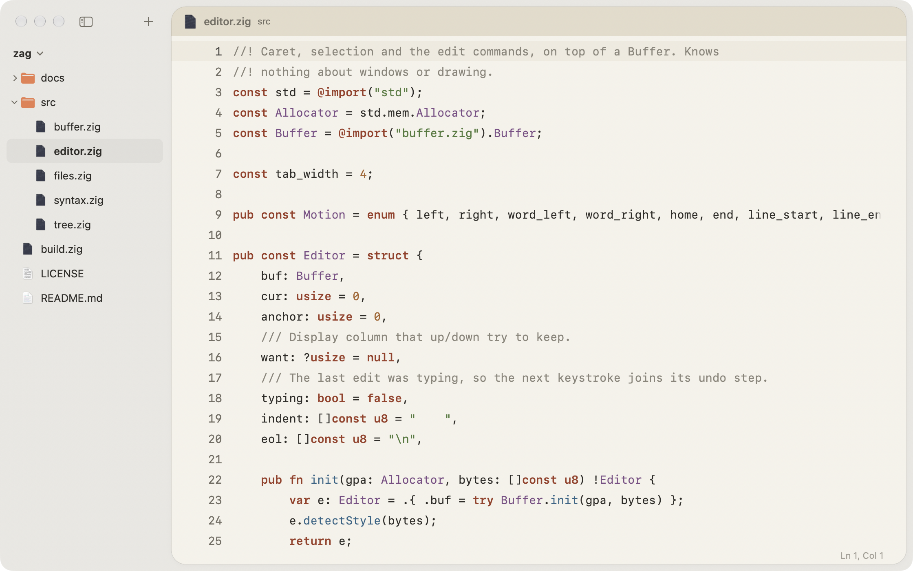

# Zag

Zag is a small native text editor for macOS on Apple Silicon, written from scratch in Zig. The 0.1.0 executable is 436,560 bytes (about 426 KiB, signature included), the compressed `.dmg` is 366,969 bytes (about 358 KiB), and Zag links only Apple's system frameworks (`AppKit`, `QuartzCore`, `CoreText`, `CoreGraphics`, `CoreFoundation`) and `libc`.



## Highlights

- **Tiny and instant.** Zag draws straight onto a `CGContext` with `CoreText` glyph runs on a monospace grid and reads and writes files directly through `libc`, with no embedded runtime, webview, or third-party dependencies.
- **Cards, splits, and tabs.** Split any window side by side (`⌘D`) or top and bottom (`⇧⌘D`), drag tabs to reorder or split cards, and browse open folders in the collapsible file sidebar (`⌘\`).
- **Animated motion.** Caret glides, spring-driven tab and sidebar highlights, smooth split folds, and theme crossfades animate every layout change.
- **Quick Open and Command Palette.** Jump to any file in the open folder with fuzzy matching (`⌘P`) or run any menu command from the keyboard (`⌘K`).
- **Live Markdown Preview.** Render the active Markdown file in a companion preview window (`⇧⌘M`) with synchronized scrolling, lists, code blocks, links, and tables.
- **Focused writing modes.** Turn on Typewriter Scrolling, Focus dimming (line, sentence, or paragraph), Zen Mode (`⌃⌘Z`), or Late-Night Focus (`⌃⌘N`).
- **Atomic saves and autosaved drafts.** Zag writes a sibling temporary file, copies permissions, extended attributes, and Finder tags, `fsync`s, and swaps atomically. Zag autosaves untitled tabs to `~/Library/Application Support/zag/Drafts` and restores open windows and tabs on launch.

## Install

Requires **macOS 15 (Sequoia) or newer** on **Apple Silicon (`arm64`)**.

1. Download `Zag-0.1.0-arm64.dmg` from the [latest release](https://github.com/hkay-dev/zag/releases/latest).
2. Open the disk image and drag **Zag** into **Applications**.
3. If macOS Gatekeeper blocks the first launch of an unnotarized build, clear the quarantine attribute once in Terminal and open Zag:

```sh
xattr -dr com.apple.quarantine /Applications/Zag.app
open /Applications/Zag.app
```

## Build from source

Requires **Zig 0.17.0+** and Xcode Command Line Tools (with `xcrun actool` from Xcode when compiling `AppIcon.icon` for the `.app` bundle).

```sh
# Build the stripped ReleaseSmall binary (zig-out/bin/zag)
zig build --release

# Run the editing, buffer, syntax, tree, finder, file, and settings tests
zig build test

# Build Zag.app (zig-out/Zag.app)
./scripts/bundle.sh stable

# Build the compressed macOS disk image (zig-out/Zag-0.1.0-arm64.dmg)
./scripts/dmg.sh
```

By default on outside machines, `scripts/bundle.sh` and `scripts/dmg.sh` apply an ad-hoc code signature (`-`). Pass `CODESIGN_IDENTITY` to sign with an Apple Developer ID or local certificate:

```sh
CODESIGN_IDENTITY="Developer ID Application: Your Name (TEAMID)" ./scripts/dmg.sh
```

## Keyboard shortcuts

| Action | Shortcut |
| --- | --- |
| New tab / New window | `⌘T` / `⌘N` |
| Open file or folder | `⌘O` |
| Quick Open file in folder | `⌘P` |
| Command Palette | `⌘K` |
| Save / Save As | `⌘S` / `⇧⌘S` |
| Close tab / Close window | `⌘W` / `⇧⌘W` |
| Split right / Split down | `⌘D` / `⇧⌘D` |
| Focus card left / right | `⌥⌘←` / `⌥⌘→` |
| Previous / next tab | `⇧⌘[` / `⇧⌘]` (or `⌃⇧⇥` / `⌃⇥`) |
| Toggle sidebar | `⌘\` |
| Find / Find and Replace | `⌘F` / `⌥⌘F` |
| Go to Line | `⌘L` |
| Toggle Comment | `⌘/` |
| Format JSON | `⌥⌘J` |
| Soft Wrap | `⌥Z` |
| Markdown Preview | `⇧⌘M` |
| Zen Mode / Late-Night Focus | `⌃⌘Z` / `⌃⌘N` |
| Font panel / Bigger / Smaller / Actual Size | `⇧⌘T` / `⌘=` / `⌘-` / `⌘0` |
| Settings (`config.toml`) | `⌘,` |

## Settings and themes

Press `⌘,` to open `~/.config/zag/config.toml` inside Zag. Zag watches the file and applies saved edits right away across every open window.

Built-in light themes include **Paper** (default), **Ayu Light**, **One Light**, **Solarized Light**, and **Gruvbox Light**. Built-in dark themes include **Ink** (default), **Ayu Dark**, **One Dark**, **Solarized Dark**, **Gruvbox Dark**, and **Black** (OLED). Override any individual theme slot with `light.<slot> = "#RRGGBB"` or `dark.<slot> = "#RRGGBB"`.

Read the full user manual in [docs/guide/index.md](docs/guide/index.md). Design notes on binary size and animation appear in [docs/decisions/tiny-binary.md](docs/decisions/tiny-binary.md) and [docs/decisions/motion.md](docs/decisions/motion.md).

## Acknowledgments

See [THIRD_PARTY_NOTICES.md](THIRD_PARTY_NOTICES.md) for acknowledgments and inspirations.

## License

MIT License. See [LICENSE](LICENSE).
