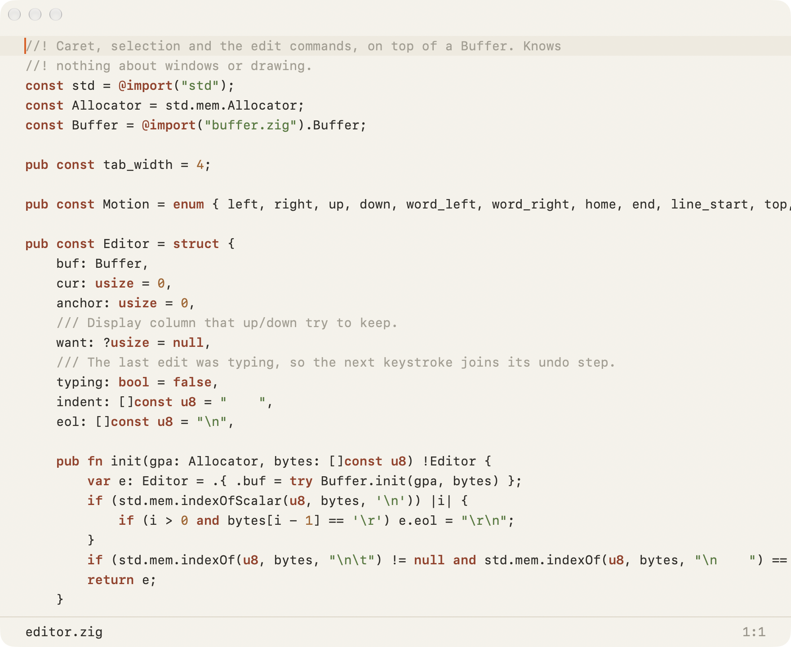

# ze

A tiny native text editor for macOS on Apple Silicon, written in Zig. One window per file, no
terminal, no file tree, no tabs (macOS window tabs still work). The release binary is about
110 KB and links only AppKit, Core Animation, CoreText, CoreGraphics and libc.



## Build

Needs Zig 0.17 and macOS 15 or later.

```sh
zig build --release          # zig-out/bin/ze
zig-out/bin/ze [file or folder]...
zig build test
scripts/bundle.sh            # zig-out/ze.app, for Finder and `open`
```

The guide is in [docs/guide](docs/guide/index.md).
