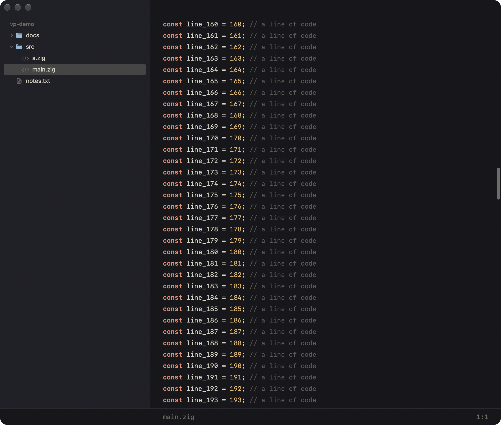
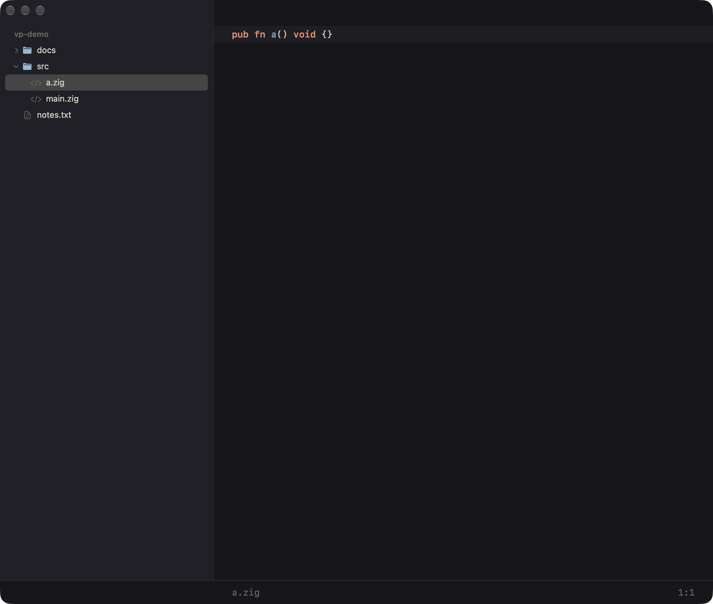

# Zig Editor: Help menu: macOS menu search (⇧⌘/) and 7 more

Changed: ze acts more like a Mac app now: a Help menu with menu search, right-click menus, Finder drops, a sidebar you can resize with a Finder-style highlight that greys out in background windows, a thin scroll bar while you scroll, and a pointer that hides while you type.
Try: open a folder in ze, drag the sidebar's edge wider, then right-click a file in the sidebar. Not tried yet: the sidebar drag, Finder drops and the right-click menus haven't been tried by hand.

## What changed

- New: Help menu with the Mac's menu search: press Shift Command / and type to find any command. (zig-editor#gdsa)
- Improved: The mouse pointer hides while you type and comes back when you move the mouse. (zig-editor#vbmf)
- New: Right-click the text or a sidebar file for a menu of common commands. (zig-editor#fa06)
- New: Drop files or a folder from Finder onto a ze window to open them. (zig-editor#8v2p)

## News

### Scrolling: thin scroll bar that shows while scrolling

New: A thin scroll bar shows while you scroll and fades out after. (zig-editor#keyg)

### Inactive windows: grey sidebar selection, dim bottom line

Improved: Windows in the background grey their sidebar highlight and dim the bottom line. (zig-editor#f68r)

### Sidebar: rounded inset selection like Finder

Improved: The sidebar marks the current file with a rounded, inset highlight like Finder's. (zig-editor#76h8)

### Sidebar: drag its edge to change its width

New: Drag the sidebar's edge to change its width; ze remembers it. (zig-editor#z539)

## Calls

- The sidebar width is one shared value for every window (saved as sidebar-width, 150 to 500 points), not a width per window. (zig-editor#z539)
- Open in New Window is greyed out on folder rows in the sidebar menu, since a folder opens into the window you're in; Reveal in Finder and Copy Path still work there. (zig-editor#fa06)
