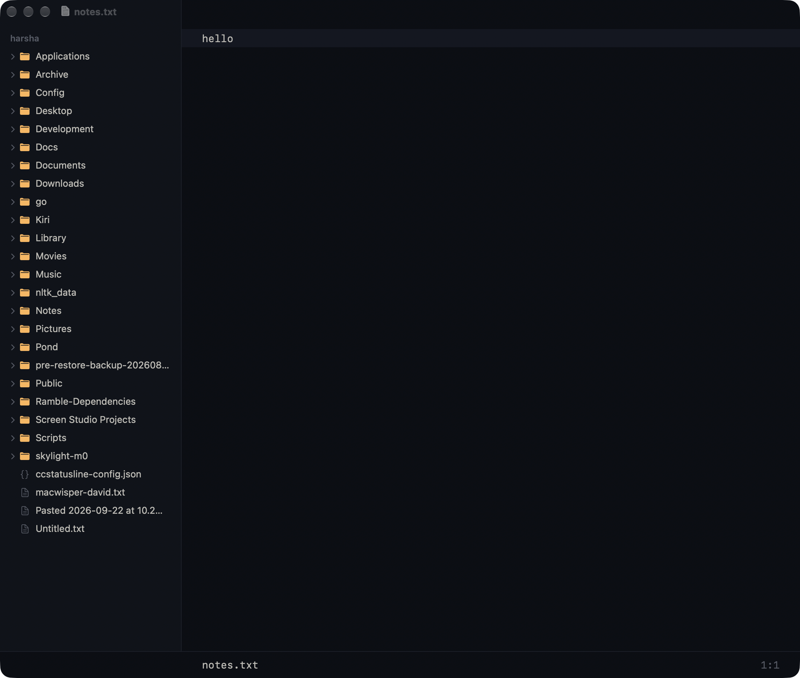

# Zig Editor: Scrolling: stretch past the ends and spring back and 1 more

Changed: Trackpad scrolling in ze now stretches past the ends of a file and springs back, and the top strip shows the file's name and icon again.
Try: Not tried yet. Pull past the top of a long file with two fingers, then Command-click the file name up top.

## What changed

- New: Scrolling past either end of a file with the trackpad stretches the page and springs back. (zig-editor#esvh)

## News

### Title strip: file name with the proxy icon

New: The top strip shows the file name with its icon; Command-click it for the folder path. (zig-editor#5xp6)

## Calls

- Left the file name where macOS puts it, beside the window buttons, instead of centering it with custom drawing that costs frame time (zig-editor#5xp6)
